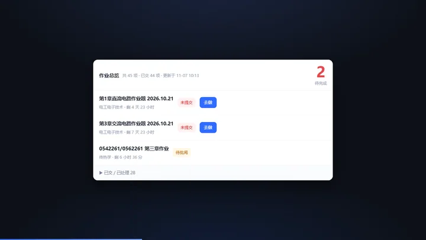

# 学习通作业总览

> 把所有课程的作业汇总成一张清单，未交的排最前。跑在自己电脑上，不依赖浏览器扩展。


网页版学习通里，作业散落在每门课的「作业」标签下，没有一个总清单，很容易漏交。这个小工具把作业、题目、解析和知识点汇总到一个本地页面里。

## 功能

| 模块 | 说明 |
| --- | --- |
| **作业看板** | 未交的按截止时间排序，24 小时内橙色、已截止红色；已交折叠 |
| **题库** | 抓取已交作业的题干、选项、正确答案和你的作答，按课程分类检索 |
| **解析与知识点** | 调用大模型给每题写解析和知识点标签，并按课程汇总成复习提纲 |
| **教材梳理** | 没布置作业的课，可以挂一本教材，按章生成「核心知识点 / 重点 / 难点 / 常见题型」 |
| **试卷导入** | 外部试卷可以整理成题库的一节（题干 + 逐题解析） |
| **导出** | 单文件 HTML（公式已排成 MathML，双击即看）+ Markdown |



## 快速开始

需要 [Node.js](https://nodejs.org/) 18 或更高版本（本机已装则跳过）。

1. 双击 **`app/启动作业总览.bat`**
2. 会自动打开 `http://127.0.0.1:7788/`
3. 首次打开登录一次学习通（手机号 + 密码）
4. 黑色的命令行窗口是本地服务，不要关；关掉就是退出

## 配置模型（可选）

不配置也能用作业看板和题库抓取，只是「生成解析」会提示未配置。

```bash
cp app/config.example.json app/config.json
```

```json
{
  "baseUrl": "https://api.deepseek.com/v1",
  "apiKey": "sk-...",
  "model": "deepseek-chat",
  "textbooks": {
    "电工电子技术": "中国电力出版社《电工电子技术》（第二版）"
  }
}
```

任何兼容 OpenAI `/chat/completions` 的服务都能用。

## 工作原理

```
作业聚合页  GET mooc1-api.chaoxing.com/work/stu-work
课程名映射  GET mooc1-api.chaoxing.com/mycourse/backclazzdata?view=json&mcode=
题目详情    任务页内联 JS 里的 selectWorkQuestionYiPiYue 地址（自带 enc 签名）+ isReport=false
```

- 登录走 `passport2.chaoxing.com/fanyalogin`，手机号和密码用 AES-128-CBC 加密后提交（密钥是学习通前端自己的常量）
- 题目页一次返回整份作业，含正确答案标记和学生的作答
- 公式统一用 LaTeX 存，页面用 KaTeX 渲染，导出时转 MathML

## 数据与隐私

- 所有数据都在本机：`app/.session.json`（cookie）、`app/config.json`（API key）、`app/data/bank.json`（题库）
- 这三个文件都在 `.gitignore` 里，不会被提交
- 密码不落盘，除非主动勾选「记住密码」
- 服务只监听 `127.0.0.1`，局域网内其他设备访问不到

## 已知限制

- 只抓**已提交**的作业，未交的不抓
- 「已互评」类作业的页面结构与普通作业不同，目前拿不到题目详情
- 依赖学习通网页版的页面结构，改版后可能失效
- 仅供个人学习使用，请勿用于批量刷课、代做作业等违反平台规则的行为

## 目录结构

```
app/
  server.js              本地服务：登录、抓取、解析、题库、导出
  public/index.html      看板 + 题库页面
  public/vendor/katex/   公式排版引擎（本地内置，不联网）
  config.example.json    模型配置示例
  data/                  运行时生成，题库
docs/
  promo.html             动效宣传页（可循环播放）
  promo.webp / .gif      同一段动效的图片版
```

## License

MIT
